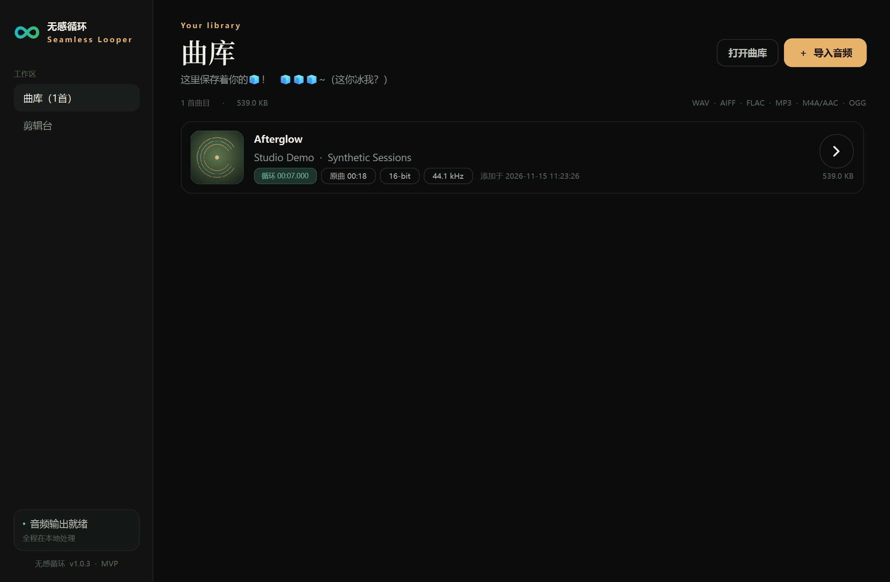
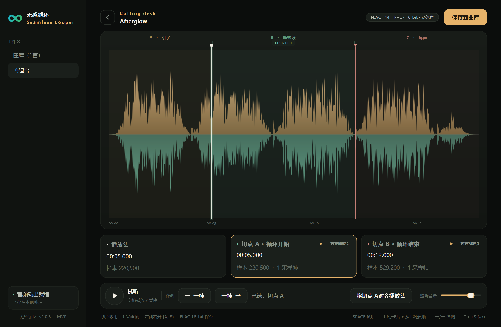
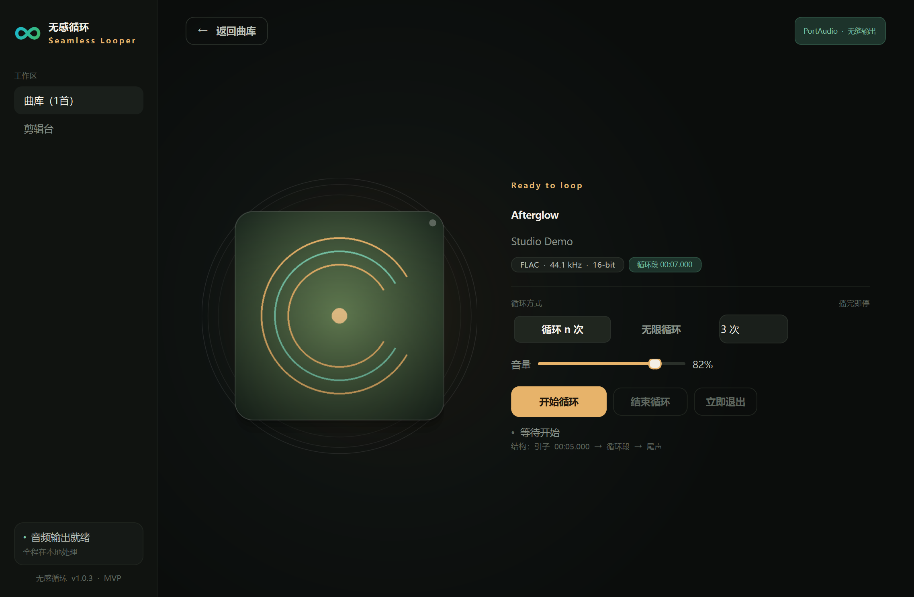

# 无感循环 · 溜🧊溜大了做出来的

> 嫌喜欢的歌曲没有加长版？单曲循环听不够、听不爽？  
> 本项目提供一种解决方案：自己制作加长版！  
> 把一首音乐拆成「引子 / 循环 / 尾声」，让循环无感，溜到爽为止！  
> 核心特性：**无损处理** + **无缝播放**

无感循环是一个本地运行的音频剪辑器 + 循环播放器，使用 Python、PySide6、ffmpeg 与 PortAudio。







## 功能

- **精确剪辑**：波形上拖动播放头与两个切点；切点吸附 WAV/FLAC 采样帧或压缩格式的编码帧/包边界。
- **切点试听**：点击切点卡片上的 ▶，播放头会跳到该切点并立即开始试听，方便检查接缝。
- **无损保存**：不重采样、不改声道、不做二次有损编码；三段音频保存后即可长期使用。
- **真正无缝播放**：一条长期存在的输出流贯穿开头 → 循环 → 尾声，段间和循环间不重启流、不补静音。
- **三种打断**：暂停 / 继续、结束循环、立即退出。
- **曲库**：显示循环时长、源参数和添加时间；点击曲目只打开播放器，不会自动播放。
- 播放界面不显示进度条或播放进度，这是刻意的设计。

## 快速开始

要求 Python 3.10+，并准备 ffmpeg / ffprobe。

```bash
python -m pip install -r requirements.txt
python app.py
```

也可以双击 `run.bat`，或启动时直接导入音频：

```bash
python app.py "D:\Music\example.flac"
```

ffmpeg 查找顺序：

1. 环境变量 `LOOPSTUDIO_FFMPEG` / `LOOPSTUDIO_FFPROBE`
2. 项目内的 `bin\ffmpeg.exe` 与 `bin\ffprobe.exe`
3. 系统 `PATH`

便携版放置说明见 [bin/README.txt](bin/README.txt)。仓库不附带任何音频文件；`library/` 是用户数据目录。

## 使用

1. 点击「导入音频」，选择文件。
2. 拖动播放头和切点 A / B。选中某个时间卡片后，可以用 `←` / `→` 逐帧微调。
3. 需要精确对齐时：
   - 把播放头放到目标位置，点切点卡片上的「对齐播放头」；
   - 或点切点卡片上的 ▶，直接从该切点开始试听。
4. 按空格试听 / 暂停。
5. 点击「保存到曲库」，填写标题和艺术家。
6. 在曲库中点击曲目，只打开播放器；选择「循环 n 次」或「无限循环」，再点「开始循环」。
7. 播放中可以：
   - **暂停**：再次点击继续；
   - **结束循环**：播完当前这一遍循环后进入尾声；在引子中点击会跳过全部循环，在尾声中无效；
   - **立即退出**：立即停止并关闭输出流。

## 支持格式

所有输入先解码为 PCM，再按样本切割。

| 输入 | 切点边界 | 保存格式 |
|---|---|---|
| WAV / AIFF | 采样帧 | 同参数 WAV / AIFF |
| FLAC | 采样帧 | FLAC |
| ALAC / M4A | 采样帧 | FLAC |
| MP3 | 编码帧（MPEG-1 1152 / MPEG-2 576 采样） | FLAC |
| AAC / M4A | AAC 编码帧（1024 采样） | FLAC |
| Ogg Opus | 包边界 | FLAC |
| Ogg Vorbis | 包边界 | FLAC |

16/24-bit 源保持位深；32-bit PCM 源用 64-bit 中间量处理；有损格式保存为 24-bit FLAC。不要对压缩格式直接做字节切割，这样可以避开 MP3 bit reservoir、AAC 重叠、Opus pre-skip 等前导样本问题。

## 技术要点

- `sounddevice.OutputStream` 从第一段一直开到结尾；段切换和循环重复都是生产者侧的连续取数，不重建流。
- 有界队列提供背压；PortAudio 回调只做内存拷贝。
- 循环遍数由绝对计数状态机推进，不依赖块大小整除。
- 剪辑器只绘制一张非对称波形（上 L / 下 R），并缓存为两张位图；播放时只重绘标记，避免 GUI 和音频线程争抢 GIL。
- 播放设置保存在项目根目录的 `settings.ini`。

## 开发

```text
app.py                      启动入口
seamless_looper/            通用代码包
  audio_io.py               解码、帧网格、无损切片、曲库
  playback.py               播放状态机与音频流
  editor.py                 波形、切点、试听
  player.py                 播放器页面
  library.py                曲库
  main_window.py            应用外壳与页面路由
  workers.py                后台导入 / 保存
  widgets.py, theme.py      组件与视觉
tests/                      单元测试
tools/selftest_audio.py     声卡播放自检
bin/                        可选的便携 ffmpeg
library/                    用户曲目（不入库）
docs/                       README 附加文档
```

测试：

```bash
python -m unittest discover -s tests -v
python tools/selftest_audio.py
```

`selftest_audio.py` 会以 0 音量实际占用默认声卡，验证几条播放路径和 underrun 情况。

## 已知限制

- 不提供播放进度拖动。无限循环哪来的进度条。
- 输出设备不支持源采样率或多声道时会明确报错，不做静默重采样或下混。
- 32-bit FLAC 会改为保存 32-bit WAV（libsndfile 写入限制），仍然无损。
- Opus / Vorbis 的包边界由包时间戳和时长推算，不同 ffmpeg 版本可能有细微差异。

## Vibe Coding 说明

本项目使用 DeepSeek Harness 制作，DeepSeek-V4.1-Flash-1017 提供大模型支持；本人进行了部分 UI 设计方面的工作。

首轮提示词详见 [docs/prompt.txt](docs/prompt.txt)，仅供参考。（备注：除了那个表格，剩下的提示词都是我自己写的；原提示词就是 Markdown 格式。）